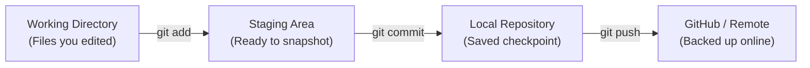

# 🛠️ Essential Git & GitHub Cheat Sheet for Beginners

A quick-reference guide for student developers at IIIT Trichy.

---

## ⚡ The Daily Workflow (90% of what you do)



```bash
# 1. Check what you changed
git status

# 2. Stage all changed files
git add .

# 3. Save a checkpoint with a message
git commit -m "Describe your change briefly"

# 4. Upload your checkpoint to GitHub
git push origin <branch-name>
```

---

## 🚀 First-Time Setup (Once per laptop)

```bash
# Set your name and email (matches your GitHub account)
git config --global user.name "Your Name"
git config --global user.email "your-email@example.com"

# Check your config
git config --list
```

---

## 📂 Starting a Project

```bash
# Clone an existing online repo to your computer
git clone https://github.com/IIIT-Trichy-Devs/<repo-name>.git

# Or initialize Git in an existing folder on your computer
cd my-project
git init
git branch -M main
```

---

## 🌿 Branching (Safe Experimentation)

Always create a new branch when working on a new feature or bug fix:

```bash
# Create and switch to a new branch
git checkout -b feature/my-new-feature

# List all local branches (current one marked with *)
git branch

# Switch back to main
git checkout main

# Update your local main branch with the latest changes from GitHub
git pull origin main
```

---

## 🆘 Oops! How to Fix Common Beginner Mistakes

### 1. I made a typo in my last commit message
```bash
git commit --amend -m "Correct commit message"
```

### 2. I edited a file and broke everything, I want to undo changes to that file
```bash
git restore <filename>
```

### 3. I accidentally staged a file with `git add` that I didn't want to commit
```bash
git restore --staged <filename>
```

### 4. Git says: `fatal: refusing to merge unrelated histories` or `Updates were rejected because the remote contains work`
Fetch and merge the latest remote work:
```bash
git pull --rebase origin main
```

---

## 🎓 Next Steps
- Try making your first PR on **[community/MEMBERS.md](https://github.com/IIIT-Trichy-Devs/community/blob/main/MEMBERS.md)**!
- Need help? Ask in **[GitHub Discussions](https://github.com/IIIT-Trichy-Devs/community/discussions/categories/q-a)**.
